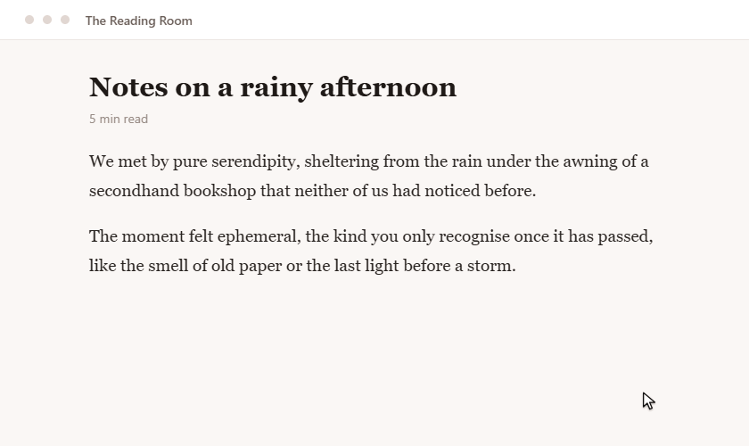
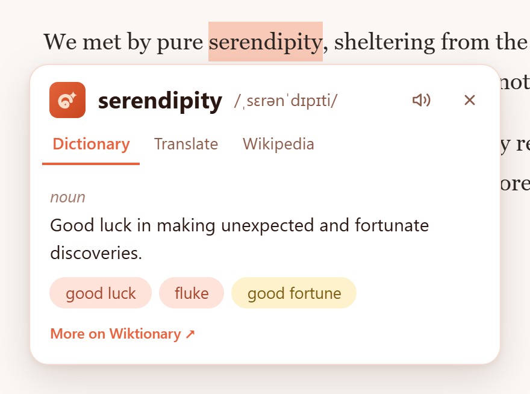
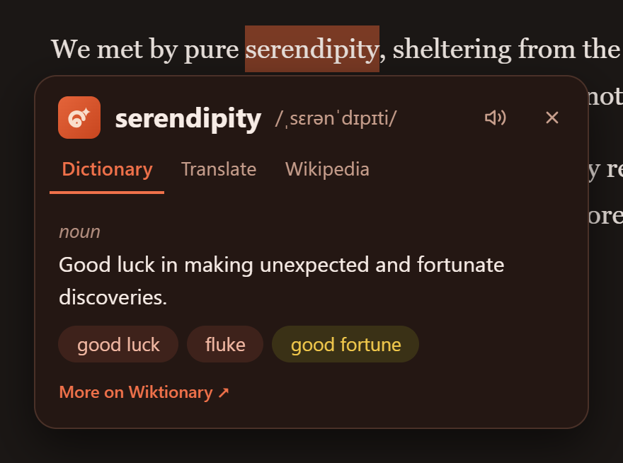
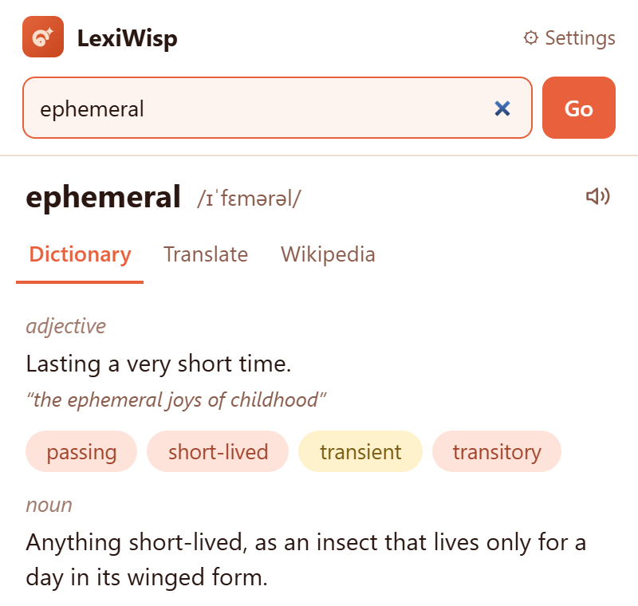
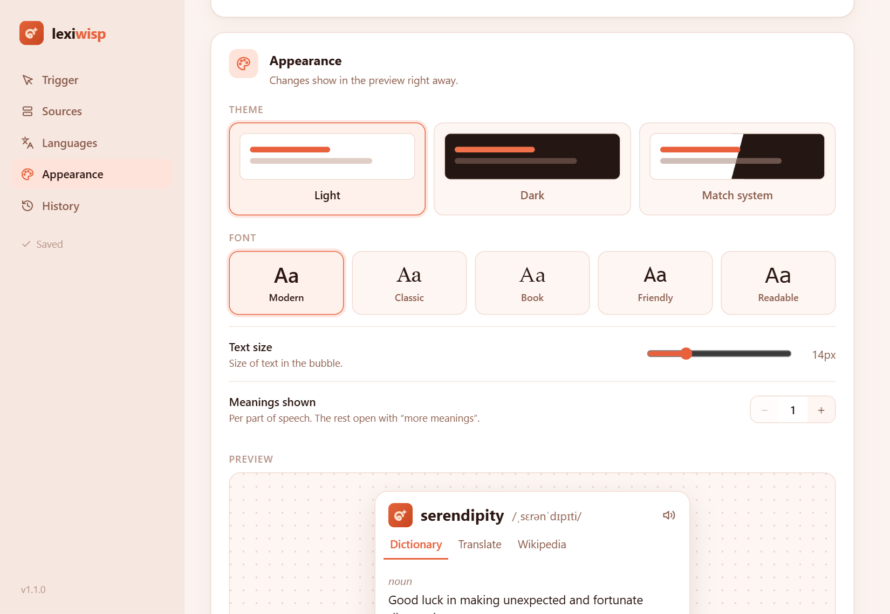

<p align="center">
  
</p>

<h1 align="center">LexiWisp</h1>

<p align="center">
  <b>Double-click any word. Get a simple meaning instantly, even offline.</b><br>
  A popup dictionary &amp; translator for Chrome.
</p>

<p align="center">
  <a href="https://github.com/cosmos117/LexiWisp/releases/latest"></a>
  
  
  
  <a href="LICENSE"></a>
</p>

<p align="center">
  
</p>

## Why LexiWisp

- **Instant.** About 82,000 English words and phrases ship inside the extension, so meanings appear in milliseconds without waiting on a server.
- **Simple.** One plain-English meaning per part of speech. More meanings are one click away.
- **Stays out of your way.** The bubble opens next to the word and closes on <kbd>Esc</kbd> or when you click anywhere else.

## Install

1. Download **`lexiwisp-v*.zip`** from the [latest release](https://github.com/cosmos117/LexiWisp/releases/latest) and unzip it.
2. Open `chrome://extensions` and turn on **Developer mode** (top right).
3. Click **Load unpacked** and select the unzipped folder.

Then double-click any word on any page. Other Chromium-based browsers, such as Edge and Brave, load it the same way from their extensions page.

## Features

- **Offline dictionary**: WordNet 3.1 definitions and CMU pronunciations (IPA). Understands word forms: *ran → run*, *children → child*, *happier → happy*.
- **Related words**: click a chip to look up a synonym or related word.
- **Translate**: translates into 40+ languages, with alternative translations for single words.
- **Wikipedia**: article summary with thumbnail, in your chosen language.
- **Urban Dictionary**: optional tab for slang and internet terms.
- **Pronunciation**: plays recorded audio when available, otherwise your browser's voice.
- **Your trigger**: double-click, select text, or select while holding Alt / Ctrl / Shift. Also the right-click menu and <kbd>Alt</kbd>+<kbd>D</kbd>.
- **Make it yours**: light, dark or system theme, 5 fonts, text size and tab order.
- **History**: recent lookups in the toolbar popup, with CSV export. Stored only in your browser.

## Screenshots

<table>
  <tr>
    <td></td>
    <td></td>
  </tr>
  <tr>
    <td align="center">Light</td>
    <td align="center">Dark</td>
  </tr>
  <tr>
    <td></td>
    <td></td>
  </tr>
  <tr>
    <td align="center">Toolbar popup</td>
    <td align="center">Settings</td>
  </tr>
</table>

## Privacy

- English definitions come from the built-in dictionary. **Nothing is sent anywhere** for those.
- The **Translate**, **Wikipedia** and **Urban** tabs send the selected text to Google Translate, Wikipedia and Urban Dictionary respectively. They are loaded in the background so switching tabs is instant. Turn off any you don't want in **Settings → Sources**.
- Words missing from the built-in dictionary are looked up on the Free Dictionary API and Wiktionary.
- History and settings stay in your browser. There are no accounts, analytics or tracking.

## Development

```
manifest.json
assets/                    logo (SVG). icons/ holds the PNG sizes
data/dict/                 offline dictionary shards (generated)
src/background.js          service worker: lookups + cache, context menu, shortcut, history
src/sources.js             dictionary / translate / wikipedia / urban sources
src/offline-dictionary.js  reads data/dict, handles word forms
src/shard.js               word → shard file mapping (shared with the build script)
src/shared/defaults.js     default settings, languages, fonts
src/shared/render.js       the bubble UI + theme CSS (used by the page bubble, popup and settings preview)
src/content/content.js     selection detection and bubble positioning
src/popup/, src/options/   toolbar popup and settings page
tools/                     build-dictionary.mjs, package.mjs
docs/                      README images
```

Load the repo folder with **Load unpacked** while developing. After editing files, click ↻ on the extension card.

**Package a release zip** (writes `dist/lexiwisp-v<version>.zip`):
```sh
node tools/package.mjs
```

**Rebuild the offline dictionary** (only needed when changing the build script):
```sh
# in any scratch folder
npm i --ignore-scripts wordnet-db cmu-pronouncing-dictionary
# then, from this repo
node tools/build-dictionary.mjs <scratch>/node_modules/wordnet-db <scratch>/node_modules/cmu-pronouncing-dictionary
```

**Add a source:** add a fetcher to `SOURCES` in `src/sources.js`, its host to `host_permissions` in `manifest.json`, a label and renderer in `src/shared/render.js`, and an entry in `sources` in `src/shared/defaults.js`.

## Credits

- Definitions: [WordNet 3.1](https://wordnet.princeton.edu/), Princeton University
- Pronunciations: [CMU Pronouncing Dictionary](http://www.speech.cs.cmu.edu/cgi-bin/cmudict), Carnegie Mellon University

Their license texts are in [`data/dict/LICENSES.txt`](data/dict/LICENSES.txt).

## License

LexiWisp is released under the [MIT License](LICENSE). The bundled dictionary data keeps its own licenses (see Credits).
